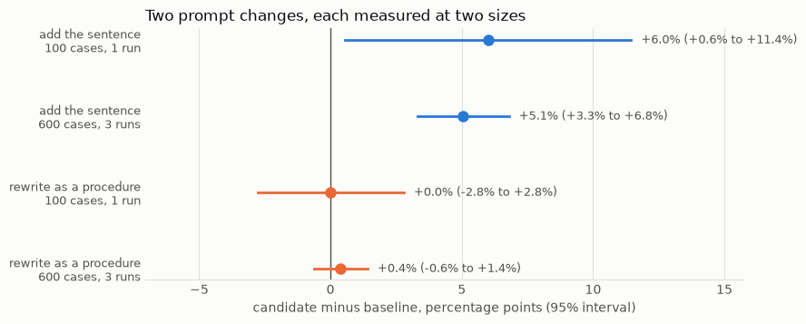

# Is the new prompt actually better?

[](https://github.com/EasternPeace/eval-error-bars/actions/workflows/ci.yml)

A Claude Cookbook recipe on judging a prompt change with error bars instead of two bare
scores.

You rewrite a prompt, rerun your eval, and the score goes up a few points. Is the new
prompt better, or was it a lucky run? An eval is a sample of cases, and the model answers
differently from run to run, so a single score cannot say. This recipe shows how to put a
confidence interval on a score and on the difference between two prompts, how to tell
run-to-run noise from case-to-case noise, and how to size an eval before paying for it.

**Read the notebook: [guide.ipynb](evals/prompt_comparison_error_bars/guide.ipynb).** It is
fully executed, so the outputs are there without running anything.

## The worked example

A made-up refund desk: 600 synthetic requests, each with a correct decision that comes
from the policy written as code. Claude Haiku 5.5 gets the policy as three system prompts,
three runs each, through the Message Batches API.

| Prompt | Score (95% interval) |
|---|---|
| `draft`: the policy in prose, missing one sentence | 92.9% (91.2% to 94.7%) |
| `prose`: the draft plus that sentence | 98.0% (97.2% to 98.8%) |
| `procedure`: the policy rewritten as a checklist | 98.4% (97.6% to 99.2%) |

That gives two prompt changes to judge, and they come out differently:

| Change | Difference (95% interval) | Verdict |
|---|---|---|
| Add one sentence (`draft` to `prose`) | **+5.1 points (+3.3 to +6.8)** | better |
| Rewrite as a procedure (`prose` to `procedure`) | **+0.4 points (-0.6 to +1.4)** | not measurable |

The full run of 5,400 requests cost $0.57.



What the run showed:

- **One sentence did the work.** The draft never says what happens to a request that no
  rule allows, and the model escalated those instead of denying them. This was a real gap
  in an earlier version of this recipe, found in review.
- **The big rewrite did not measurably help.** Its interval is tight enough to rule out a
  drop of more than about 0.6 points, so it can be adopted for readability, but not sold
  as an improvement. Broken down by policy rule, it trades fewer mistakes on approvals for
  more on gift cards.
- **A typical first eval settles neither.** At 100 cases and one run, the first change
  came out as +0.6 to +11.4 points and the second as -2.8 to +2.8.
- **More than half of the noise was between runs**, and adding cases still beat adding
  runs at equal cost.

## Layout

The recipe lives in `evals/prompt_comparison_error_bars/`, the path it is meant to have in
[anthropics/claude-cookbooks](https://github.com/anthropics/claude-cookbooks). Its own
[README](evals/prompt_comparison_error_bars/README.md) lists the files, the assumptions,
and the failures the code handles.

| Path | What it is |
|---|---|
| `guide.ipynb` | The cookbook |
| `error_bars.py` | Intervals, the paired difference, an exact sign test, a bootstrap cross-check, variance components, sample size. Standard library and NumPy only |
| `refund_task.py` | The policy as code, a seeded case generator, and the three prompts |
| `batch_runner.py` | One request per prompt, case, and run through the Message Batches API, and the grading |
| `evaluation/run_eval.py` | A release gate with two modes: the candidate is measurably better, or it is not worse by more than a margin |
| `results/` | The recorded run |
| `tests/` | Offline tests |

## Run it

```bash
uv sync
uv run pytest
uv run python evals/prompt_comparison_error_bars/evaluation/run_eval.py
```

The tests and the gate make no API calls. Running the notebook or a fresh eval needs
`ANTHROPIC_API_KEY` in `.env` (see `.env.example`).

## How it is tested

- **The statistics** are checked against hand arithmetic and by simulation: a 95% interval
  has to cover the true value in about 95% of simulated experiments, an A/A comparison has
  to raise a false alarm about 5% of the time, and the sample-size formula has to deliver
  the power it promises.
- **The dataset** is checked against hand-written cases for every policy rule and
  threshold, and the committed file has to match the generator.
- **The runner and the gate** run against a fake client.
- **The prose** is checked against the data: a test recomputes every figure quoted in the
  READMEs and the notebook from the recorded run.
- **The notebook** has to pass the structural checks the Claude Cookbook's CI applies.

## Method

The statistics follow Evan Miller, [Adding Error Bars to Evals: A Statistical Approach to
Language Model Evaluations](https://arxiv.org/abs/2411.00640) (2024).

## License

MIT
